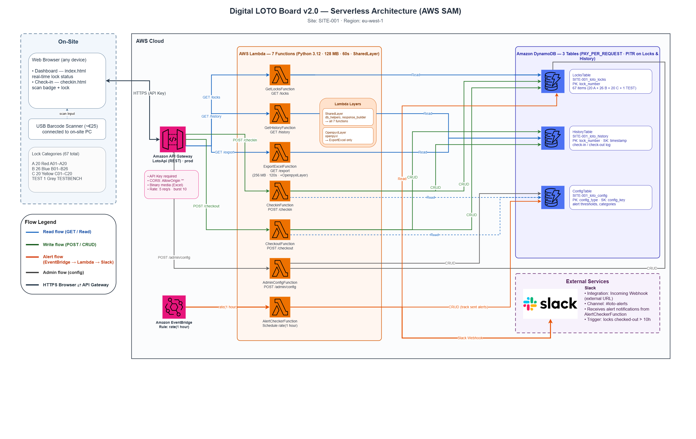

# Digital LOTO Board

**Cloud-native serverless system for digitizing the Lock Out / Tag Out (LOTO) safety procedure in industrial environments.**

Built with AWS SAM, this system replaces traditional physical lock boards with a real-time web dashboard featuring barcode-based authentication, automated alerting, and a complete audit trail — deployed at **~$0.35/month**.

> **[🎮 Live Demo](demo.html)** — download `demo.html` and open it in any browser.  
> No backend, no API keys, no deploy needed. Full UI with in-memory sample data.



---

## Table of Contents

- [Motivation](#motivation)
- [System Design](#system-design)
- [Architecture](#architecture)
- [Data Model](#data-model)
- [Security Model](#security-model)
- [Key Design Decisions](#key-design-decisions)
- [Lock Categories](#lock-categories)
- [Tech Stack](#tech-stack)
- [Project Structure](#project-structure)
- [Deployment](#deployment)
- [Cost Analysis](#cost-analysis)
- [Failure Modes & Resilience](#failure-modes--resilience)
- [Demo](#demo)
- [License](#license)

---

## Motivation

LOTO (Lock Out / Tag Out) is a mandatory safety procedure in manufacturing and logistics: before performing maintenance on equipment, an operator places a physical lock on the energy isolation point and attaches a tag identifying who locked it, when, and why. This prevents accidental re-energization and is regulated by standards such as OSHA 29 CFR 1910.147.

Traditional LOTO boards are physical panels where locks are tracked manually — a process that is error-prone, non-auditable, and provides no real-time visibility. This project addresses three core problems:

| Problem | Impact | Solution |
|---------|--------|----------|
| **No real-time visibility** | Supervisors cannot see which locks are in use without physically inspecting the board | Real-time web dashboard with 15-second polling |
| **No audit trail** | Lock operations are not recorded; disputes cannot be resolved | Append-only DynamoDB history table with full traceability |
| **Human error in identification** | Operators may write the wrong badge or lock number | Barcode scanning on both badge and lock eliminates transcription errors |

## System Design

The system is designed around three principles:

1. **Zero-server operations** — fully serverless; no EC2 instances, no patching, no scaling configuration
2. **Event-driven alerting** — an independent scheduled Lambda detects locks exceeding a configurable threshold (default: 10 hours) and pushes Slack alerts, regardless of whether anyone is viewing the dashboard
3. **Separation of concerns** — each Lambda function maps to exactly one API endpoint with least-privilege IAM permissions; a shared layer provides common database and response utilities

## Architecture

> 📐 Editable diagram: [`docs/architecture_diagram.drawio`](docs/architecture_diagram.drawio) (open with [draw.io](https://app.diagrams.net/))

```
┌──────────────────┐
│  Browser + USB    │
│  Barcode Scanner  │
└────────┬─────────┘
         │ HTTPS
         v
┌────────────────────────────────────────────────────────────────────┐
│  AWS Cloud                                                         │
│                                                                    │
│  ┌─────────────────────┐     ┌──────────────────────────────────┐ │
│  │  API Gateway (REST)  │────▶│  7 Lambda Functions (Python 3.12)│ │
│  │  API Key auth        │     │                                  │ │
│  │  CORS enabled        │     │  checkin    ─┐                   │ │
│  └─────────────────────┘     │  checkout   ─┤  ┌─────────────┐ │ │
│                               │  get_locks  ─┼─▶│  DynamoDB   │ │ │
│  ┌─────────────────────┐     │  get_history ─┤  │  3 tables   │ │ │
│  │  EventBridge (1h)    │────▶│  export_excel─┤  │  PITR on    │ │ │
│  └─────────────────────┘     │  admin_config─┤  └─────────────┘ │ │
│                               │  alert_checker┘                  │ │
│                               └──────────┬───────────────────────┘ │
│                                          │                         │
│                                          v                         │
│                               ┌──────────────────┐                │
│                               │  Slack Webhook    │                │
│                               │  (alert channel)  │                │
│                               └──────────────────┘                │
└────────────────────────────────────────────────────────────────────┘
```

### Data Flow

Every operation follows a consistent pattern:

1. Browser sends an HTTPS request to **API Gateway**
2. API Gateway validates the **API Key** and invokes the appropriate **Lambda**
3. Lambda validates all inputs against the **loto_config** table (badge exists, lock exists, state is consistent)
4. Lambda reads/writes **loto_locks** for current state and appends to **loto_history** for the audit trail
5. The dashboard polls `GET /locks` every **15 seconds** to refresh the UI

## Data Model

Three DynamoDB tables, all using on-demand billing (`PAY_PER_REQUEST`) with Point-in-Time Recovery enabled.

### `loto_locks` — Current State

Real-time state of every lock. Contains exactly 67 items at all times.

| Attribute | Type | Key | Description |
|-----------|------|-----|-------------|
| `lock_number` | String | PK | Lock identifier (e.g. `A05`, `B14`, `C03`) |
| `status` | String | — | `free` or `checked_in` |
| `user` | String | — | Operator login (from badge scan) |
| `badge_id` | String | — | Scanned badge number |
| `equipment` | String | — | Equipment being locked out |
| `reason` | String | — | Reason for lockout |
| `checkin_time` | String (ISO 8601) | — | UTC timestamp of check-in |

### `loto_history` — Audit Log

Append-only record of every operation. Rows are never updated or deleted.

| Attribute | Type | Key | Description |
|-----------|------|-----|-------------|
| `lock_number` | String | PK | Partition key |
| `timestamp` | String (ISO 8601) | SK | Sort key — server-generated UTC timestamp |
| `action` | String | — | `check_in` or `check_out` |
| `user_in` / `user_out` | String | — | Operator who performed the action |
| `duration_minutes` | Number | — | Lock duration (check-out events only) |

### `loto_config` — Configuration

Centralized configuration managed via the Admin panel. Stores badge mappings, lock definitions, locations, reasons, and alert tracker state.

| Attribute | Type | Key | Description |
|-----------|------|-----|-------------|
| `config_type` | String | PK | `badge_map`, `lock_list`, `locations`, `reasons`, `alert_tracker` |
| `config_key` | String | SK | The specific value (badge ID, lock number, etc.) |
| `value` | String | — | Associated data (login, category, etc.) |
| `active` | Boolean | — | Soft-delete flag |

## Security Model

Five layers of defense:

| Layer | Control | Mechanism |
|-------|---------|-----------|
| **Authentication** | API Key | Every request requires `x-api-key` header; key is revocable in <30 seconds |
| **Origin control** | CORS | API Gateway restricts accepted origins |
| **Input validation** | Server-side | Every Lambda validates badge, lock existence, and state consistency |
| **Least privilege** | IAM | Each Lambda has only the DynamoDB permissions it needs (read-only or CRUD) |
| **Data protection** | PITR | Continuous backup with 1-second granularity, 35-day retention |

## Key Design Decisions

| Decision | Rationale |
|----------|-----------|
| **DynamoDB over RDS** | No connection pooling needed; on-demand pricing matches the bursty, low-volume traffic pattern (~3,000 ops/month). PITR provides continuous backup without manual snapshots. |
| **One Lambda per endpoint** | Maximizes least-privilege isolation — a read-only endpoint cannot accidentally write data. Each function is independently deployable and testable. |
| **Shared layer for DB helpers** | Eliminates code duplication across 7 functions while maintaining deployment independence. |
| **Client-side polling (15s) over WebSocket** | Simpler to implement, no persistent connection management, and the 15-second refresh rate is sufficient for safety monitoring. Keeps the frontend a single static HTML file. |
| **EventBridge for alerting** | Decouples the alert check from user activity — alerts fire even if no operator is using the dashboard. Anti-spam logic prevents duplicate alerts within a configurable cooldown window. |
| **Single-file frontend (no build step)** | The dashboard is one self-contained HTML file with inline CSS/JS. No npm, no webpack, no CI pipeline for the frontend — deploy by copying a file. |
| **DEMO mode with placeholder detection** | The frontend auto-detects placeholder API config values and switches to in-memory demo mode, enabling instant evaluation without backend deployment. |

## Lock Categories

The system manages **67 locks** across 3 categories plus one test lock:

| Prefix | Count | Color | Auth Method |
|--------|-------|-------|-------------|
| **A** | 20 | 🔴 Red | Badge scan (operator login) |
| **B** | 26 | 🔵 Blue | Badge scan (operator login) |
| **C** | 20 | 🟡 Yellow | Manual entry (contractor company + employee) |
| **TEST** | 1 | ⚪ Grey | Test bench |

Category codes are configurable — their meaning depends on the site.

## Tech Stack

| Layer | Technology | Purpose |
|-------|-----------|---------|
| **IaC** | AWS SAM (CloudFormation) | Single-command deploy of all resources |
| **Compute** | AWS Lambda (Python 3.12) | 7 microservices, 128 MB, 60s timeout |
| **Database** | Amazon DynamoDB | 3 tables, on-demand billing, PITR |
| **API** | Amazon API Gateway (REST) | API Key auth, CORS, binary media support |
| **Scheduling** | Amazon EventBridge | Hourly alert check trigger |
| **Alerting** | Slack Workflow Webhook | Push notifications for overdue locks |
| **Excel export** | openpyxl (Lambda Layer) | On-demand `.xlsx` generation |
| **Frontend** | HTML / CSS / JavaScript | Single-file SPA, no framework, no build step |

## Project Structure

```
digital-loto-board/
├── README.md
├── demo.html                           ← Interactive demo (open in browser)
├── .gitignore
│
├── v2_cloud/
│   ├── README.md                       ← Detailed deployment guide
│   ├── test_slack.py                   ← Webhook test utility
│   ├── config_data/
│   │   ├── badge_to_login.txt          ← Badge-to-operator mappings (seed data)
│   │   └── locks_list.txt              ← Lock inventory (67 entries)
│   ├── frontend/
│   │   ├── index_cloud.html            ← Production dashboard (LIVE / DEMO mode)
│   │   └── index_demo.html             ← Standalone demo (no backend)
│   ├── infrastructure/
│   │   ├── template.yaml               ← SAM template (all AWS resources)
│   │   └── seed_data.py                ← Initial DynamoDB population script
│   ├── lambda/
│   │   ├── shared/python/              ← Shared layer (db_helpers, response_helpers)
│   │   ├── checkin/handler.py          ← POST /checkin
│   │   ├── checkout/handler.py         ← POST /checkout
│   │   ├── get_locks/handler.py        ← GET  /locks
│   │   ├── get_history/handler.py      ← GET  /history
│   │   ├── export_excel/handler.py     ← GET  /export
│   │   ├── admin_config/handler.py     ← POST /admin/config
│   │   └── alert_checker/handler.py    ← EventBridge (hourly)
│   └── layers/
│       ├── build_openpyxl_layer.sh     ← Layer build script (Linux/Mac)
│       ├── build_openpyxl_layer.ps1    ← Layer build script (Windows)
│       └── openpyxl/requirements.txt
│
└── docs/
    ├── architecture.md                 ← Full architecture document
    ├── architecture_diagram.drawio     ← Editable diagram (draw.io)
    └── architecture_diagram.png        ← Rendered diagram
```

## Deployment

### Prerequisites

- AWS CLI configured (`aws configure`)
- AWS SAM CLI (`pip install aws-sam-cli`)
- Python 3.12

### Steps

```bash
# 1. Build the openpyxl Lambda Layer (once)
cd v2_cloud/layers
bash build_openpyxl_layer.sh          # Linux/Mac
# powershell -File build_openpyxl_layer.ps1  # Windows

# 2. Deploy all AWS resources
cd ../infrastructure
sam build
sam deploy --guided \
  --parameter-overrides \
    SiteName=MY-SITE \
    SlackWebhookUrl='https://hooks.slack.com/...'

# 3. Seed initial data
python seed_data.py --site MY-SITE --region eu-west-1

# 4. Configure the frontend
# Update CONFIG in index_cloud.html with the API URL and API Key from stack outputs
```

## Cost Analysis

Based on 67 locks, ~3,000 operations/month, dashboard polling every 15 seconds:

| Service | Detail | Cost/month |
|---------|--------|------------|
| DynamoDB | 3 tables, on-demand, PITR | ~$0.25 |
| Lambda | ~3,000 invocations, 128 MB | ~$0.00 |
| API Gateway | ~90,000 requests (polling) | ~$0.10 |
| EventBridge | 1 hourly rule | ~$0.00 |
| CloudWatch | Lambda logs | ~$0.00 |
| **Total** | | **~$0.35/month** |

**Hardware (one-time):** USB barcode scanner (~€25) + barcode labels (~€5) = **~€30**.

## Failure Modes & Resilience

| Failure Scenario | Impact | Mitigation |
|-----------------|--------|------------|
| Site PC shuts down | Dashboard not visible | Open browser on any other device |
| Internet outage | Cannot check in/out | No data loss — resume when connected |
| Lambda cold start | ~200ms added latency | Negligible for this use case |
| Lambda crash | Single operation fails | Auto-retry (up to 2 attempts) |
| Accidental data deletion | Data lost | PITR: restore to any second within 35 days |
| API Key compromised | Unauthorized access | Revoke and regenerate in <30 seconds |
| Barcode scanner failure | Cannot scan | Fallback: manual text input in the UI |

## Demo

The fastest way to evaluate the system:

1. Download [`demo.html`](demo.html) from the repository root
2. Open it in any browser
3. Walk through the full workflow: badge scan → lock selection → check-in → dashboard view → check-out → history

The demo runs entirely client-side with in-memory sample data covering all 67 locks across 3 categories, including pre-populated history entries. No server, no API, no AWS account required.

## License

[MIT License](LICENSE)
